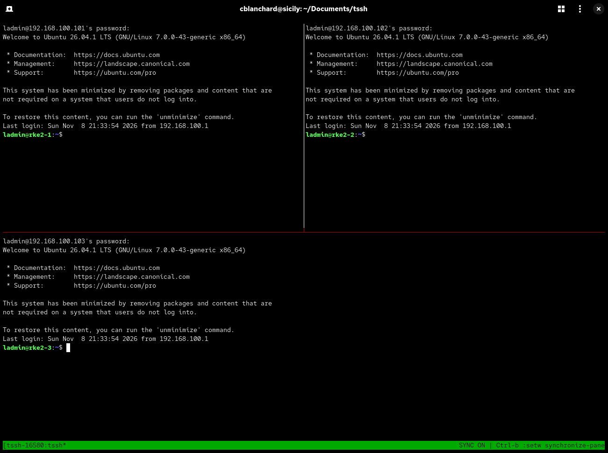

# tssh

A lightweight alternative to ClusterSSH (`cssh`) for systems with no GUI and no X11. It is a small wrapper around **tmux**: give it a list of hosts and it opens one SSH session per host in a tiled tmux layout with synchronized input, so whatever you type goes to every host at once.

## Goal

ClusterSSH needs a graphical X11 environment (Perl/Tk), so it can't run on headless servers, minimal installs, or plain SSH sessions without X forwarding. `tssh` aims to give you the same "type once, run on many hosts" workflow with nothing but `bash`, `ssh`, and `tmux`:

- Works on GUI-less systems and systems without X11
- Works over a plain SSH session
- No Perl, Tk, or X libraries
- A single shell script, easy to read and modify

It was written with RHEL 10 in mind, but it runs anywhere bash and tmux are available.

## Requirements

- `bash`
- `tmux`
- `ssh` client

If tmux is missing, the script tells you and exits:

```
Error: tmux is not installed.
Install it with:  sudo dnf install tmux
```

## Installation

```bash
sudo install -m 755 tssh /usr/local/bin/tssh
```

Or, without root:

```bash
mkdir -p ~/bin
install -m 755 tssh ~/bin/tssh
```

Make sure `~/bin` is in your `PATH`.

## Usage

```bash
tssh {user@host1,user@host2,user@host3}
```

Example:

```bash
tssh {ladmin@192.168.100.101,ladmin@192.168.100.102,ladmin@192.168.100.103}
```




### Accepted host formats

All of these do the same thing:

```bash
tssh {ladmin@192.168.100.101,ladmin@192.168.100.102,ladmin@192.168.100.103}
tssh ladmin@192.168.100.101 ladmin@192.168.100.102 ladmin@192.168.100.103
tssh "ladmin@192.168.100.101,ladmin@192.168.100.102"
tssh ladmin@192.168.100.{101..103}
```

Bash expands unquoted `{a,b,c}` into separate arguments before the script runs. The script also strips literal braces and splits on commas and whitespace, so quoted input works too.

## How it works

1. Checks that tmux is installed.
2. Parses the host list.
3. Creates a detached tmux session named `tssh-<pid>` with the first host.
4. Splits a new pane for each remaining host and re-tiles the layout after each split.
5. Turns on `synchronize-panes`.
6. Attaches to the session, or switches to it if you are already inside tmux.

Each run creates its own session, so you can run several `tssh` clusters at once.

## Key bindings

The tmux prefix is `Ctrl-b` unless you have changed it.

| Keys | Action |
|------|--------|
| `Ctrl-b :` then `setw synchronize-panes` | Toggle synchronized input on or off |
| `Ctrl-b` + arrow keys | Move between panes |
| `Ctrl-b z` | Zoom the current pane (press again to restore) |
| `Ctrl-b d` | Detach, leaving the session running |
| `exit` in a pane | Close that host's session |

The status bar shows `SYNC ON` as a reminder that input is being sent to all panes.

## Tips

- **Password authentication:** with sync on, type the password once and it goes to every pane. Key-based auth is smoother: `ssh-copy-id ladmin@192.168.100.101` for each host.
- **Type into one host only:** toggle sync off, work in that pane, then toggle it back on.
- **Reattach after detaching:** `tmux ls` to find the session, then `tmux attach -t tssh-<pid>`.
- **Many hosts:** the layout is tiled, so very large clusters get small panes. Use `Ctrl-b z` to zoom one in.
- **Different SSH options:** put them in `~/.ssh/config` (ports, keys, jump hosts) and the script will pick them up.

## Troubleshooting

| Problem | Fix |
|---------|-----|
| `tssh: command not found` | Check the install path is in `PATH`, or run `./tssh` directly |
| `tmux is not installed` | `sudo dnf install tmux` |
| A pane closes immediately | The SSH connection failed. Run `ssh user@host` by hand to see the error |
| Only some hosts appear | Check for typos or stray spaces in the host list |
| `no space for new pane` | Terminal window is too small for the number of hosts. Enlarge it |

## Limitations

- Commands you type are sent to all panes, including mistakes. Double-check before running anything destructive while sync is on.
- Hosts are connected using plain `ssh user@host`. There is no built-in option for per-host ports or identity files; use `~/.ssh/config` for that.
